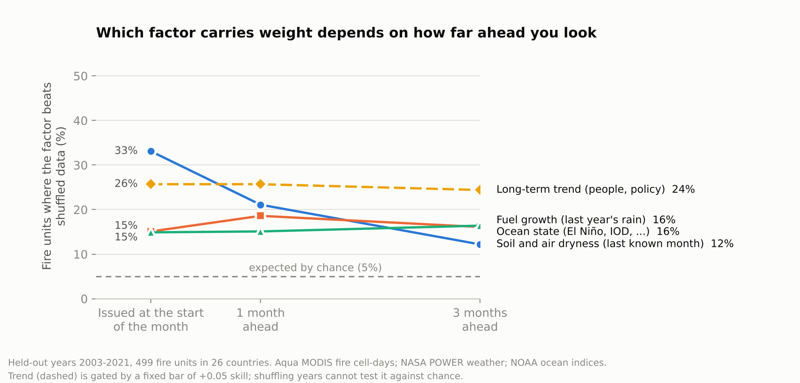
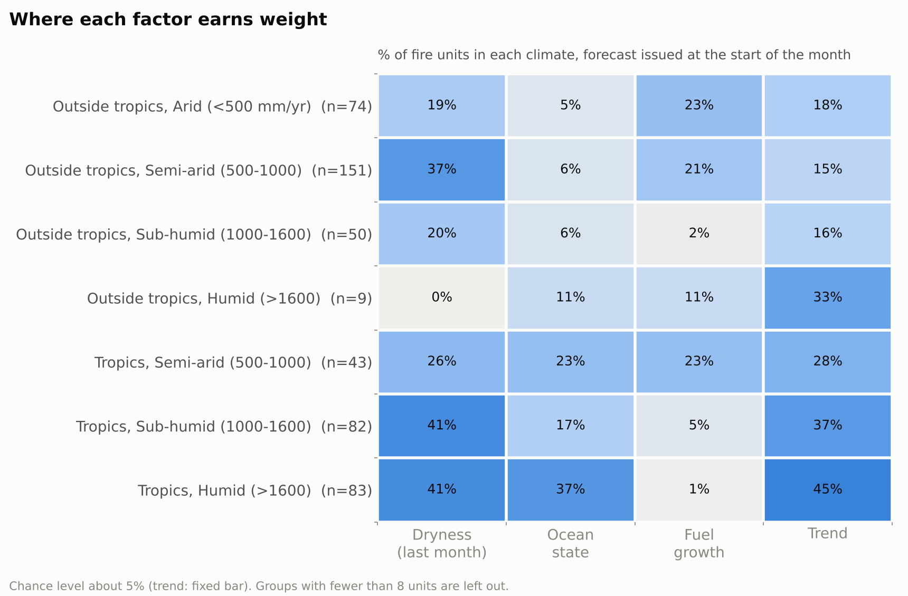

# Prediction engine: which factors drive fire, where, and how far ahead

Built and verified 14 Nov 2026 with an AI assistant (log this for the SI usage note). Code: [`../engine/`](../engine/). Results: [`engine-results/`](engine-results/). Verification report: [`engine-results/verification/`](engine-results/verification/). It answers features **C2** (our own forecast model) and **S3** (risk outlook), and complements **M13** (chance of fire).

Tags: `[V]` computed today from NASA or NOAA data with the code in `engine/` · `[D]` secondary source or recalled · `[U]` our inference.

## The answer in six lines

1. **Dryness of soil and air is the main short-range factor.** Issued at the start of a month, it earns weight in **33%** of fire units, against **5%** by chance. Its value fades with lead time (21% one month ahead, 12% three months ahead), because moisture has a memory of weeks `[V]`.
2. **The ocean state (El Niño and relatives) is the long-range factor, and only in the tropics.** It earns weight in **38%** of humid tropical units but at chance level (6%) outside the tropics, and its share grows with lead time `[V]`.
3. **Fuel growth matters only where fuel is scarce.** Last year's rain earns weight in **21–24%** of arid and semi-arid units and **1–5%** of humid ones. In arid places more rain last year means **more** fire this year (in **87%** of arid units) `[V]`.
4. **People set the level.** A long-term trend earns weight in about **25%** of units, most often in humid tropics (46%) `[V]`.
5. **On years it never saw (2022–2025), the engine beats history by 8–11% (Brier skill).** About half of that is the recent level; the physical factors add real skill **only in the wet tropics** (+16% at the start of the month, +4% three months ahead). Elsewhere they passed the held-out tests but did not carry over `[V]`. See the [verification report](engine-results/verification/).
6. **Some places can't be forecast from weather, and Bulgaria is one.** Its summer and autumn hot spots are mostly farm burning; no weather or ocean factor beats history there `[V]`.




## 1. The physics

Fire needs **fuel**, **dry fuel** and a **spark** at the same time, so expected fire activity is a product of factors:

```
fire = normal(place, month) × dryness factor × fuel factor × ocean-steered rain factor × trend
```

Taking logs turns the product into a sum, which is a regression with the normal level as a fixed offset:

```
log(1 + fire cell-days) = normal(month) + β·dryness + β·fuel + β·ocean + β·trend + noise
```

Each factor has its own memory, which is why each matters at a different lead:

| Factor group | Inputs | Physical memory | Sign expected |
|---|---|---|---|
| **Dryness now** (diagnostic only) | Same-month VPD, root-zone soil wetness, rain | Hours to days | Drier → more fire |
| **Dryness memory** | Latest known month's soil wetness and VPD; rain in the 3 months before | Weeks (deep soil, duff, peat) | Drier → more fire |
| **Fuel growth** | Rain in the 12 months ending 5 months before the target | A season to a year (grass growth) | Arid: wetter → more fire. Humid: none |
| **Ocean** | Three indices per climate zone (tropics: Niño 3.4, IOD, tropical N. Atlantic; north: Niño 3.4, NAO, PDO; south: Niño 3.4, IOD, SAM) | Months | Region-specific |
| **Trend** | Year, frozen at 2021 for forecasts (never extrapolated) | Years (people, land use, policy) | Either |

VPD (vapour pressure deficit) is how strongly the air pulls water out of fuel; it is computed from temperature and humidity.

## 2. Data

| What | Source | Access |
|---|---|---|
| Fire | FIRMS MODIS yearly country files, **Aqua only**, 2003–2021: one sensor, one overpass time, stable orbit. Vegetation fires, confidence ≥ 30, fire cell-days on a 0.01° grid. 26 countries, 2.3 GB. **Aug 2020 excluded** (Aqua outage: no data is not zero) | No login |
| Weather and soil moisture | **NASA POWER** monthly (T max, humidity, rain, root-zone soil wetness from MERRA-2), sampled at the 1° cells holding most of each unit's fire, weighted by fire | No login |
| Ocean and atmosphere | NOAA PSL Niño 3.4 and TNA; NOAA CPC DMI (ERSSTv6), NAO, AO, SAM; NOAA NCEI PDO. All current to Aug–Oct 2026. Download: `engine/fetch_indices.py` | No login |

**Why Aqua only works for a VIIRS-era product:** the engine learns **anomalies**, this year against the same place's normal, and a constant sensor factor cancels out of an anomaly.
- **Checked on 76 units, 2012–2021:** MODIS and VIIRS anomalies correlate at a median **r = 0.91** `[V]`.
- **But VIIRS swings are smaller:** the median slope is **0.79**, because MODIS sees a larger share of the fire in big years. So the outlook also states factors at VIIRS level (`factor_viirs = factor^0.79`).

The ENSO dashboard the team uses as a reference shows the El Niño state as a variable to account for. The engine reads the same NOAA files directly, and the dashboard's typical-impact list is an outside check (89% agreement, verification M38).

## 3. Units: tiles × fire kind × season

- **5° tiles** (about 500 km) within each country, named by their south-west corner (`lat0_lon0`), the same convention as the app's `tiles/<lat0>_<lon0>` files. Conditions are local: a country-wide average failed for Canada.
- **Two fire kinds,** told apart by a physical signature, since a land-cover map needs a NASA login:
  - **recurrent:** a ~5 km cell that burned in 10 or more of the 19 years. Fuel that regrows within a year: farmland, pasture, savanna.
  - **episodic:** burned in fewer years. Forest, shrubland, peat.
  - The split is stable: 92% of fire keeps its kind when built from half the years. **MCD12C1 land cover is the upgrade.**
- **Seasons:** the months holding the fire, split when they aren't contiguous; a Nov–Feb season stays one season across New Year.
- **Result:** 483 units in 26 countries (308 episodic, 175 recurrent). 16 more were dropped and listed: their fire sits on coasts where the sampling point falls over the sea, and NASA POWER has no soil moisture there.

## 4. How the weights are decided

**Lead L:** issued at the start of the month L months before the target, using data up to the month before issue. "diag" uses same-month weather and is not a forecast; it shows the physics.

**Held-out skill:** leave one year out over 2003–2021. Skill = 1 − error ÷ error of the normal alone.

**Weights = exact Shapley values of held-out skill.** A group's weight is its average gain in held-out skill over all 32 combinations of the 5 groups, and the weights add up to the full model's skill. This splits credit fairly when factors overlap: El Niño acts through rain, so ocean and dryness overlap.

**Gate against chance (M123):** the engine is rerun 3 times with the years of weather and ocean data shuffled. A factor is used in a unit only if its weight beats the 95th percentile of the shuffled weights. The trend can't be shuffled this way, so it gets a fixed bar of +0.05 skill.

| Factor (% of units passing) | Start of month | 1 month ahead | 3 months ahead | By chance |
|---|---|---|---|---|
| Dryness memory | **33%** | 21% | 12% | 5% |
| Ocean | 15% | **19%** | 16% | 5% |
| Fuel growth | 15% | 15% | **16%** | 5% |
| Trend (fixed bar) | 26% | 26% | 24% | not testable |
| Dryness now (diagnostic) | **75%** | — | — | 5% |

## 5. Which factor in which conditions

Forecast issued at the start of the month `[V]`:

| Conditions | Units | Dryness | Ocean | Fuel | Trend | Reading |
|---|---|---|---|---|---|---|
| Outside tropics, arid (< 500 mm/yr) | 70 | 20% | 6% | **24%** | 19% | Fuel-limited: a wet year grows the grass that burns next year |
| Outside tropics, semi-arid (500–1000) | 146 | **38%** | 6% | 21% | 14% | Dryness-limited, with some fuel limit |
| Outside tropics, sub-humid (1000–1600) | 49 | 20% | 6% | 2% | 16% | Weak predictability |
| Tropics, semi-arid (500–1000) | 42 | 26% | 24% | 24% | 29% | All factors matter: savanna |
| Tropics, sub-humid (1000–1600) | 79 | **43%** | 18% | 5% | 38% | Dryness, plus people |
| Tropics, humid (> 1600) | 81 | **42%** | **38%** | 1% | **46%** | Forest and peat: dryness, El Niño, land use |

**Default rules where local data is thin,** from this table and the forward test:
- **Wet tropics:** dryness and ocean together; trust them (confirmed on unseen years).
- **Arid:** fuel growth first, dryness second (held-out years only).
- **Semi-arid and sub-humid outside the tropics:** dryness one month ahead at most (held-out years only), otherwise the recent level.
- **Outside the tropics:** ignore ocean indices; they don't beat chance there.

## 6. Proof (summary; details in the [verification report](engine-results/verification/))

| Check | Result |
|---|---|
| Known answers, properties, leakage, limits, control totals, audit sample, mutation tests | **26 tests pass**; 5 of 5 planted bugs caught (one test added to catch the fifth) |
| Calibration (M112) | Forecast 12 / 27 / 41 / 58% → observed 12 / 25 / 41 / 58%. **Overconfident at the top:** 79% → 67–71%. Show "likely" rather than numbers above about 70% |
| **Forward test (M44)**: gates and fit from 2003–2021 only, scored on 2022–2025 | **+10.6% / +9.2% / +8.3%** Brier skill vs history, at the start of the month and 1 and 3 months ahead |
| Physical factors only, forward (M58) | Wet tropics +16% / +15% / +4%; elsewhere about 0 |
| Weakest slices (M124) | Largest fire units −6%; semi-arid 0%. Best: humid +29%, Nov–Jan +13–21% |
| Other satellite (M21) | Refit on Terra: main factor keeps its direction in 98% of units |
| NOAA/IRI El Niño directions (M38) | 89% of 120 units agree (chance 50%); northern Australia disagrees |
| 90% ranges (M114/M46) | Contain 94% of held-out outcomes and 86–88% of forward outcomes |

## 7. Live outlook (time-stamped, M45 + M127)

Issued **15 Nov 2026**, data to **October 2026**: [`engine-results/outlook_2026-11-15.csv`](engine-results/outlook_2026-11-15.csv) (SHA-256 `43f3bd67…d36266e`, full hash in the verification report).
- **Included:** only units whose gated model beats history on held-out years (117 units, 230 unit-months).
- **Columns:** each row has a VIIRS-level factor with a 90% range, the chances of above or below normal, the main driver, and an **evidence** label:

| Evidence label | Unit-months | Meaning |
|---|---|---|
| Confirmed on unseen years (wet tropics) | 62 | Physical factors beat history on 2022–2025 here |
| Held-out years only | 75 | Passed on 2003–2021; not confirmed after |
| Recent level only (trend) | 93 | No physical factor; "burns more or less than it used to" |

**Strongest confirmed calls:**

| Region (5° tile) | Month | Expected, VIIRS level | Chance above normal | Main driver |
|---|---|---|---|---|
| Southern New Guinea (Indonesia, −10° 135–140°) | Dec 2026 | ×7 to ×13 (90% range ×1.3 to ×100) | 90–99% | Ocean (El Niño), dryness |
| Cambodia (10° 105°) | Dec 2026 | ×2.3 | 89% | Ocean |
| Western Thailand and Myanmar border (10–15° 95°) | Jan–Feb 2027 | ×2.1 to ×2.2 | 81–87% | Ocean |
| Venezuela's llanos (0° −70°) | Dec 2026 – Feb 2027 | ×1.7 to ×2.6 | 80–86% | Ocean |

Also in the outlook, with weaker evidence:
- Eastern Australia, December: more fire likely (held-out years only).
- US Gulf coast, December: less fire likely (held-out years only).

**This El Niño is near the edge of the training data** (Niño 3.4 +2.3 °C in October `[V]`), hence the wide ranges. Score the outlook against FIRMS after February 2027.

## 8. How it plugs into the app

| App feature (spec) | What the engine provides |
|---|---|
| **M13** chance of fire this month | **Not the same quantity.** M13 is the chance of *any* fire at a place (share of past years with ≥ 1 fire). The engine forecasts whether a region's fire season will be *bigger or smaller than usual*. Show both: M13 for "does it burn here at all", the engine for "is this season unusual" |
| **C2** our own forecast model | This engine. The spec's condition ("only if it beats M13's historical chance") becomes a per-unit check: the outlook only includes units that beat history on held-out years, and labels where unseen years confirmed it |
| **S3** official fire danger | Unchanged: GWIS covers 1–9 days. The engine covers 1–3 months, where GWIS has nothing. Show both, clearly labelled |
| **M18** points-only data model | Each outlook row becomes a point at the tile centre (lat0 + 2.5, lon0 + 2.5) with `precision_radius_km` about 350 (half the tile diagonal), plus factor, range, chances, driver, evidence |
| **M6** "How we know it's right" | The two figures, the calibration table, the forward test and the physical-factors-only result |
| **S11** push alerts | Trigger only from official danger levels, or from outlook rows labelled "confirmed on unseen years". Never from the trend alone |

**Wording:** "Risk outlook (unofficial)". The chance in words ("about 8 in 10 chance of more fire than usual"; "likely" above 70%), the main driver ("strong El Niño"), and the evidence label.

## 9. Limits

- **Fire record:** Aqua MODIS only. The harmonized record (M1) should replace it as the normal level and training target once it exists.
- **Skill outside the wet tropics** rests on held-out years only, and the forward test did not confirm it.
- **Fire kind:** from a recurrence rule, not land cover.
- **Weather:** coarse (MERRA-2, about 50 km), sampled at up to 6 points per unit.
- **Not used yet:** the Copernicus fire weather index (FWI) and drought or vegetation indices. FWI is the natural next input for weeks ahead.
- **Coverage:** 26 countries across fire regimes. The team's world download runs the same code everywhere (section 10).
- **Probabilities above about 70% are overconfident.**

## 10. How to run

```bash
cd engine
python3 fetch_indices.py                       # NOAA indices -> idx/
python3 run_all.py Bulgaria Indonesia ...      # fire units, weather, Shapley weights -> results.csv
python3 null_model.py 1 11 null_0.csv          # shuffled-years null (repeat with seeds 21, 31; join as null.csv)
python3 analyze.py                             # gates, regimes, calibration, forward test -> report.json
python3 charts.py                              # the two figures
python3 outlook.py                             # live outlook -> outlook_<date>.csv
python3 -m pytest tests                        # 26 tests
```

The fire stage reads the team's yearly files from `data/raw/modis/<year>/` (from `pipeline/download_firms.py`). The `verify/` scripts reproduce the checks in the verification report.

## References

- **NASA FIRMS** MODIS Collection 6.1 yearly country files (MCD14ML): https://firms.modaps.eosdis.nasa.gov/ (doi:10.5067/FIRMS/MODIS/MCD14ML); VIIRS S-NPP 375 m files for the M21 check
- **NASA POWER** monthly and daily point API (MERRA-2 based): https://power.larc.nasa.gov/
- **NOAA PSL** Niño 3.4 and TNA: https://psl.noaa.gov/data/correlation/
- **NOAA CPC** DMI (ERSSTv6), NAO, AO, SAM, RONI: https://www.cpc.ncep.noaa.gov/
- **NOAA NCEI** PDO (ERSSTv5): https://www.ncei.noaa.gov/pub/data/cmb/ersst/v5/index/
- **NASA Earthdata**, Aqua MODIS outage 16 Aug – 2 Sep 2020: https://www.earthdata.nasa.gov/data/alerts-outages/aqua-satellite-anomaly-update
- Shapley values: L. S. Shapley 1953, "A value for n-person games" `[D]`
- Brier score: G. W. Brier 1950, *Monthly Weather Review* 78:1–3 `[D]`
- Van Wagner 1987, Canadian Forest Fire Weather Index System (moisture-code time lags) `[D]`
- Software: Python, DuckDB (MIT), pandas (BSD-3), NumPy (BSD-3), SciPy (BSD-3), Matplotlib (PSF-based), pytest (MIT), Hypothesis (MPL-2.0)
